<p align="center"></p>

<h1 align="center">Lion Satellite Studio</h1>
<p align="center"><b>Open satellite data on a live 3D globe</b><br>
Where every Earth-observation satellite is right now, what it sees, and what its data says: GOES weather from minutes ago,
night lights, NISAR radar footprints, SWOT river heights, and your own Sentinel-1 radar analyses. One small Python server, any browser.</p>

<p align="center"><em>Created by <a href="https://github.com/sunnychase">Sunny Chase</a> in collaboration with Claude (Anthropic).</em></p>

<p align="center">
  <a href="https://github.com/sunnychase/lion-satellite-studio/actions/workflows/ci.yml"></a>
  <a href="LICENSE"></a>
  <a href="#requirements"></a>
  <a href="https://cesium.com/platform/cesiumjs/"></a>
  <a href="#requirements"></a>
  <a href="#data-sources-and-licences"></a>
  <a href="https://github.com/sunnychase/lion-satellite-studio/commits/main"></a>
  <a href="https://github.com/sunnychase/lion-satellite-studio"></a>
  <a href="https://donate.stripe.com/fZuaER2Cbecw7cQ6PlfEk00"></a>
</p>

<p align="center">
  <a href="#quick-start">Quick start</a> ·
  <a href="#how-it-works">How it works</a> ·
  <a href="#features">Features</a> ·
  <a href="#point-report--what-sees-this-spot">Point report</a> ·
  <a href="#golden-gate-gallery">Gallery</a> ·
  <a href="#the-satellites--what-each-one-does">The satellites</a> ·
  <a href="#data-sources-and-licences">Data &amp; licences</a> ·
  <a href="#faq">FAQ</a> ·
  <a href="#contributing">Contributing</a>
</p>

<p align="center"><a href="docs/media/lion-satellite-studio.mp4">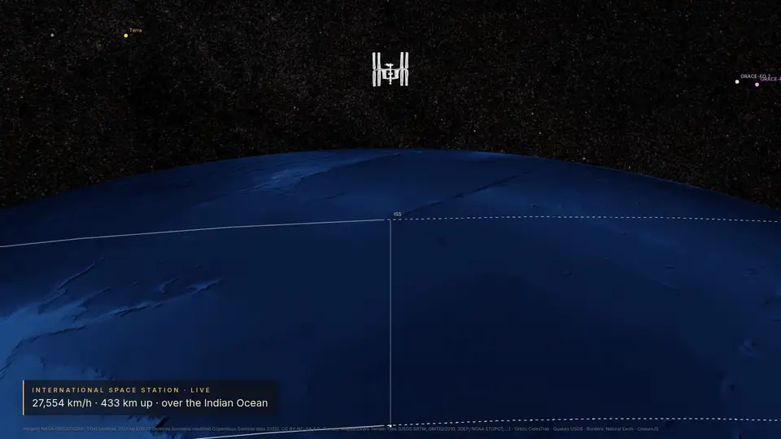</a><br>
<sub>▶ <a href="docs/media/lion-satellite-studio.mp4"><b>Watch the 81-second tour</b></a> (MP4, 1080p, silent): the fleet, all ~16,700 satellites, the ISS, GOES-East, night lights, Landsat, Everest in 3D, NISAR, SWOT and Sentinel-1 radar. Every frame is the app itself, rendered offline from its own data.</sub></p>

Lion Satellite Studio puts the open Earth-observation record on one globe you can spin. Satellite positions are computed in
your browser from CelesTrak's orbital elements; imagery comes straight from NASA GIBS; a small Python server fetches,
caches and checks everything else (NISAR footprints, SWOT water heights, earthquakes, Sentinel-1 radar) so the providers see a
handful of polite requests, not one per viewer. Nothing needs an account. Two optional live layers (ships and dark vessels)
use free keys you add yourself: live AIS ship positions from coastal receivers, plus satellite radar (Sentinel-1 and Global
Fishing Watch) that can spot ships with AIS switched off, hours after each pass.

## Quick start

```bash
git clone https://github.com/sunnychase/lion-satellite-studio.git && cd lion-satellite-studio
python3 scripts/precompress.py      # optional: gzip copies of the page's files, so it loads faster
python3 server.py                   # then open http://127.0.0.1:8640
```

That is the whole install: the server uses only the Python standard library, and CesiumJS, satellite.js, the fonts and the
3D models are in the repository. The first load fetches the satellite catalogue and imagery catalogue; after that most
requests come from the server's cache.

**Optional radar analysis** (Sentinel-1 water, change, ships and time series):

```bash
./scripts/setup_radar.sh            # a venv with numpy, scipy, rasterio, pystac, planetary-computer (~380 MB)
```

**Optional settings and a service**: copy `satellite.env.example` to `satellite.env` and edit it (port, bind address, cache
folder; see [Configuration](#configuration)). To run it in the background, adapt
[`systemd/lion-satellite-studio.service.example`](systemd/lion-satellite-studio.service.example).

## How it works

```
  browser (desktop or phone, WebGL2)
  CesiumJS globe · SGP4 in a Web Worker (satellite.js) · imagery tiles straight from NASA GIBS and EOX
        │
        │  http://127.0.0.1:8640   the page, and /api/* for everything that needs a server
        ▼
  server.py: one Python file, standard library only
  fixed-URL cached proxies: every upstream URL is a template in the code and every parameter is
  checked against a whitelist or a strict pattern, so it is not an open proxy
        │
        ├── CelesTrak ................ orbital elements (GP data)          cache ≥ 2 h per group (CelesTrak's rule)
        ├── NASA GIBS ................ layer catalogue + sub-daily times     6 h / 5 min
        ├── USGS ..................... earthquakes, last day and week       5 min
        ├── NASA FIRMS ............... VIIRS active fires, public 24 h CSVs 45 min per satellite, 40 MB cap
        ├── ASF (NISAR) .............. granule footprints → local SQLite    hourly poll + slow backfill
        ├── PO.DAAC Hydrocron (SWOT) . river and lake heights, 44 places    12 h, one request at a time
        ├── NASA Earthdata GIS ....... SWOT reaches near a point (keyless)  1 h
        ├── Planetary Computer ....... Sentinel-1/-2, Landsat, HLS, NAIP: search + tiles   1 h, tiles in memory
        │       └── analysis.py ...... optional radar worker (numpy/rasterio), one job at a time, niced
        ├── aisstream.io (your key) .. live AIS ships over one WebSocket    in memory, last 30 min
        └── Global Fishing Watch (your token)  SAR vessel detections      6 h
```

The page never talks to CelesTrak, FIRMS, ASF, Hydrocron, Planetary Computer's search, aisstream or Global Fishing Watch directly:
the server does, once, and every viewer shares the cached answer. Keys stay on the server and are never sent to the browser.
Imagery tiles (GIBS, EOX, Planetary Computer's Sentinel-1, optical and NAIP tiles through the server) and terrain load as the camera moves.

## Features

<p align="center">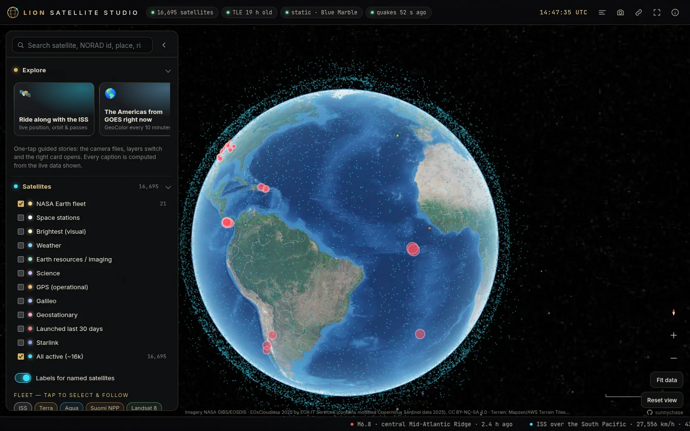</p>

| | |
|---|---|
| 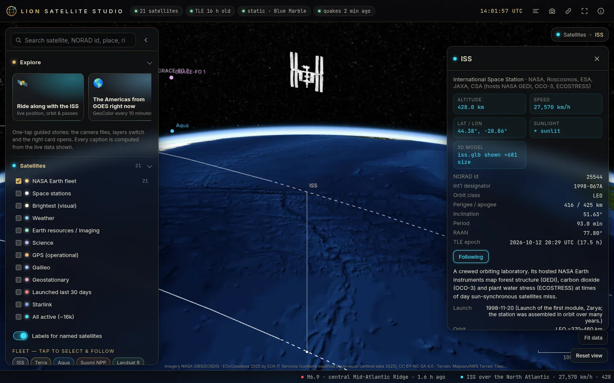 | **Every satellite, live.** The 21-satellite NASA/NOAA Earth fleet by default, or any CelesTrak group up to all ~16,700 active objects, propagated with SGP4 in a Web Worker. Tap one to follow it: a NASA 3D model, last and next orbit, altitude, speed, sunlight, and **passes over you**. |
| 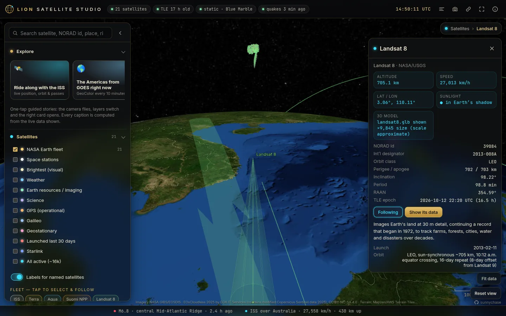 | **What it sees.** Close up, a satellite shows its instrument's field of view and the swath it sweeps on the ground (for example Landsat's 185 km), and **Show its data** switches on that satellite's own imagery layers. |
| 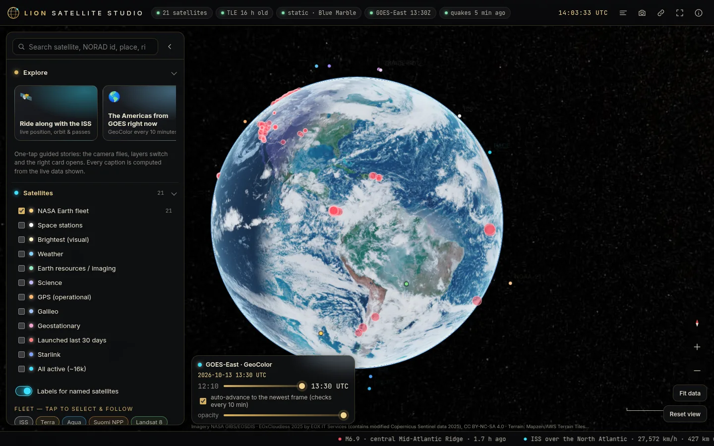 | **Near real time.** GOES-East, GOES-West and Himawari full-disk imagery from NASA GIBS, every 10 minutes, with a slider over the last day of frames; GPM IMERG precipitation every 30 minutes; today's fires from VIIRS and MODIS. |
| 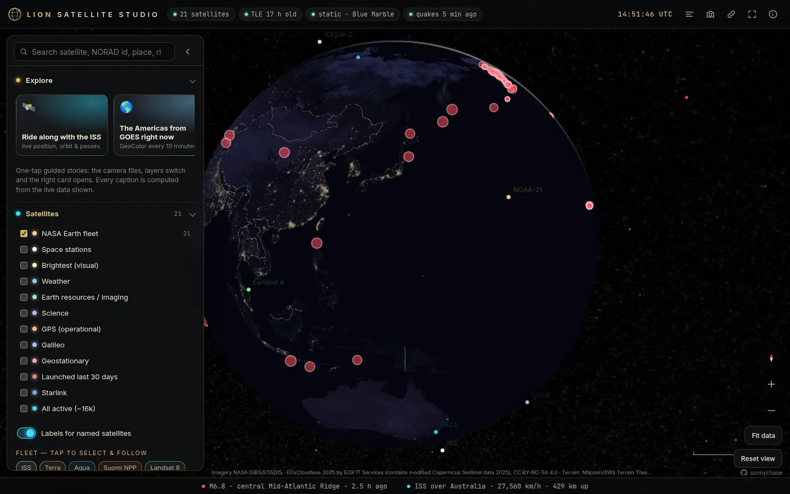 | **Day, night and science layers.** True colour from MODIS, VIIRS and PACE; night lights on the dark side only; soil moisture (SMAP), aerosols, chlorophyll (PACE), NO₂ (TEMPO), sea-surface temperature, sea ice, snow, and 30 m Harmonized Landsat Sentinel-2. |
| 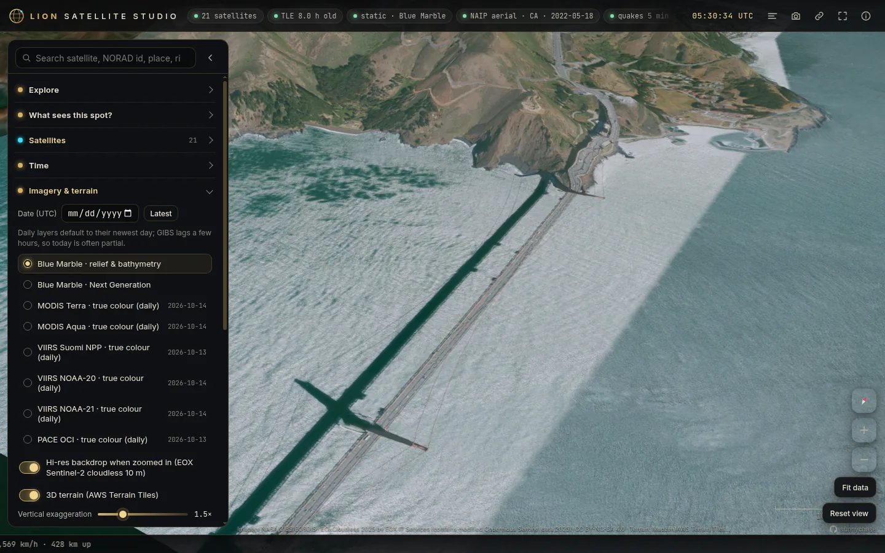 | **Aerial photos up close (US).** Below about 3 km over the United States, the newest USDA NAIP aerial photograph under the view (about 0.6 m per pixel) loads on top of the globe, with its state and date in the status bar: NAIP is flown every 2–3 years per state, so the photo is often 1–3 years old. It is freed again when you zoom out; outside the US the status bar says *no aerial here*. Switch it off under *Imagery & terrain*. |
| 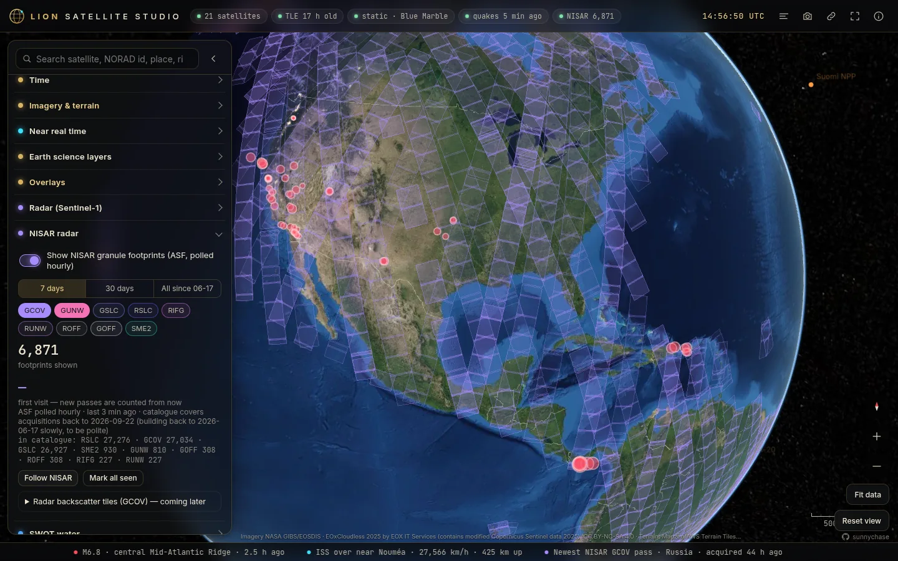 | **NISAR footprints.** Every NISAR granule ASF has published, as footprints coloured by product (GCOV, GUNW, GSLC …), newest first. Tap one for its track, frame, polarisation and size, drape the browse image, or open it in ASF Vertex. |
| 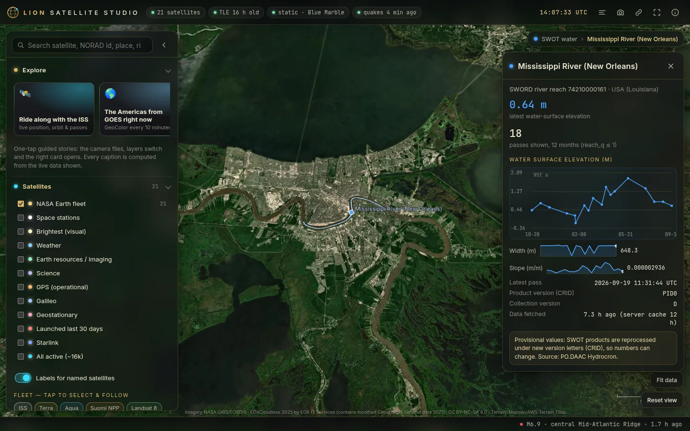 | **SWOT rivers and lakes.** Water-surface elevation, width and slope of 44 curated rivers and lakes over the last 12 months, from PO.DAAC Hydrocron, with the product version (CRID) of every value. |
| 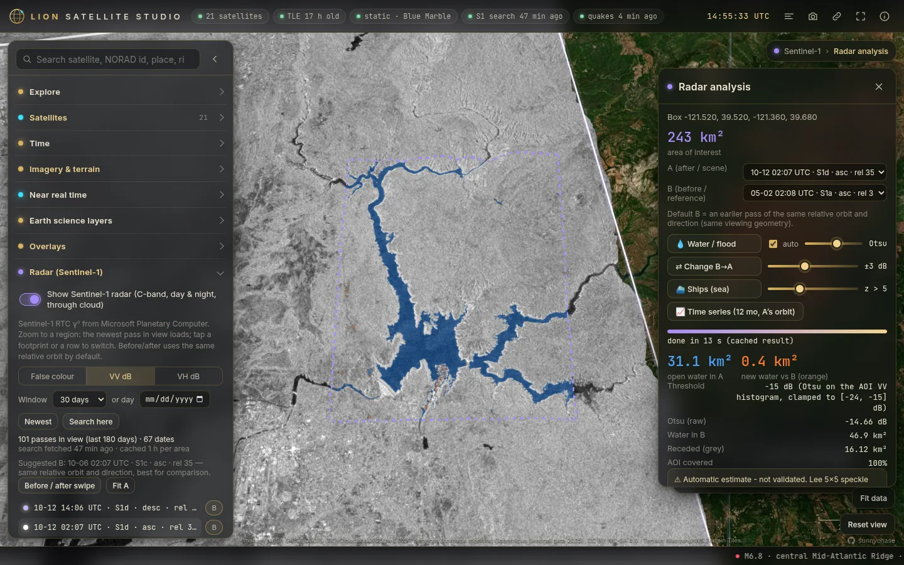 | **Your own radar analysis.** Draw a box (up to 2,500 km²) and the optional worker reads only that window of Sentinel-1 RTC from Planetary Computer: **open water** (Lee filter + Otsu threshold), **change** between two passes, **bright targets at sea** (CFAR ship detection) or a **12-month backscatter time series**. Results come with the method, the threshold and a GeoJSON download. |
| 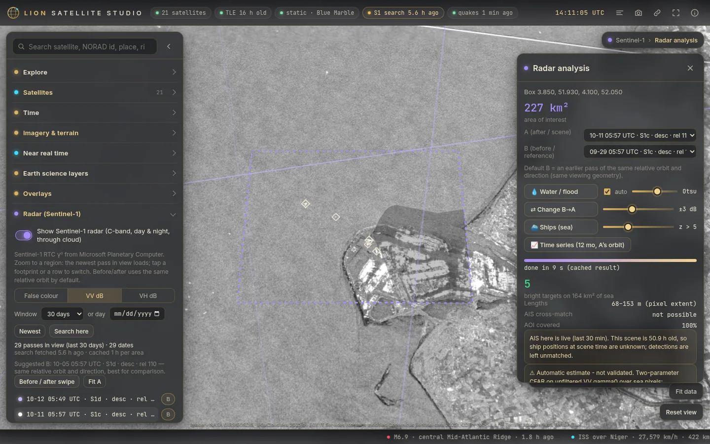 | **Ships at sea from radar.** CFAR detection over sea pixels only (Natural Earth land plus ESA WorldCover 10 m as the land mask), with length and confidence per target. With an aisstream.io key, near-live scenes are cross-checked against AIS. |
| 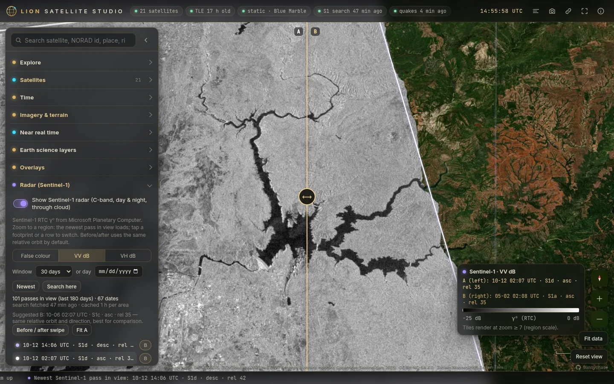 | **Before / after swipe.** Compare two radar passes of the same orbit, or radar against true colour, with a divider you drag. The *Radar sees through clouds* tour does this for you. |
| 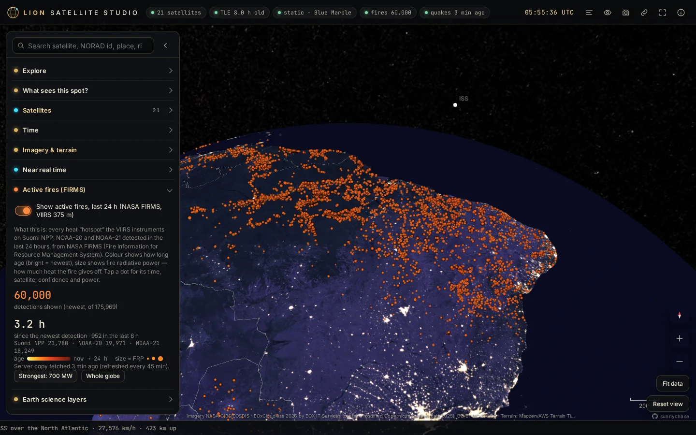 | **Active fires as points (NASA FIRMS).** Every VIIRS 375 m fire detection of the last 24 hours from Suomi NPP, NOAA-20 and NOAA-21 — about 250,000 a day; the newest 60,000 are drawn (20,000 on phones and in low-memory mode). Colour shows the age (bright = newest), size the fire radiative power; tap a dot for its time, satellite, confidence and FRP. Keyless: the server reads FIRMS's public 24-hour CSV files and caches them for 45 minutes. |
| 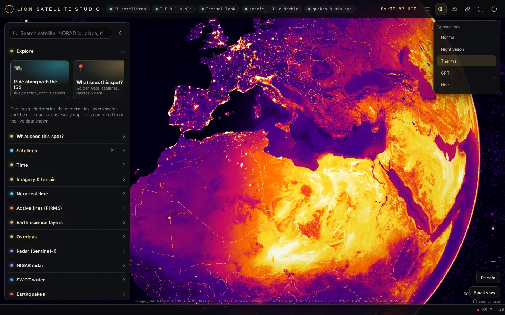 | **Sensor looks.** Night vision, Thermal (an ironbow palette on brightness — a look, not temperatures), CRT and Noir, from the eye button in the top bar or under *Imagery & terrain*. Each is one cheap full-screen shader; off by default and remembered in your browser; clicks and picking work the same in every look. |
| 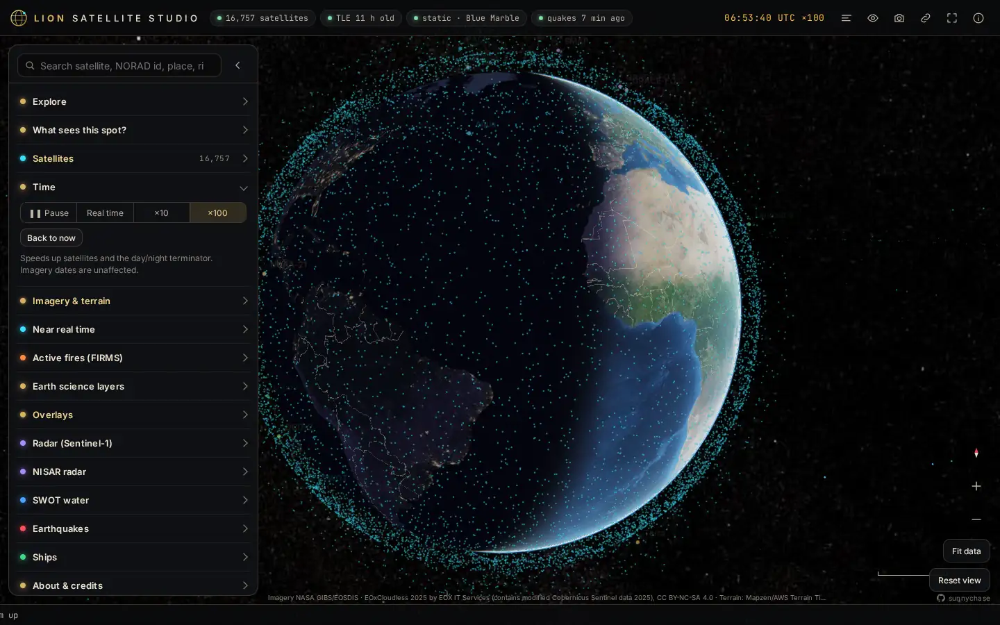 | **Smooth motion.** Satellites and AIS ships glide between data updates instead of jumping: each is dead-reckoned from its last position and velocity (course and speed for ships), never more than one update interval past the newest data. Objects behind the Earth are hidden and objects outside the view are not moved, and the page redraws only as often as the fastest visible object moves about a pixel. |
| 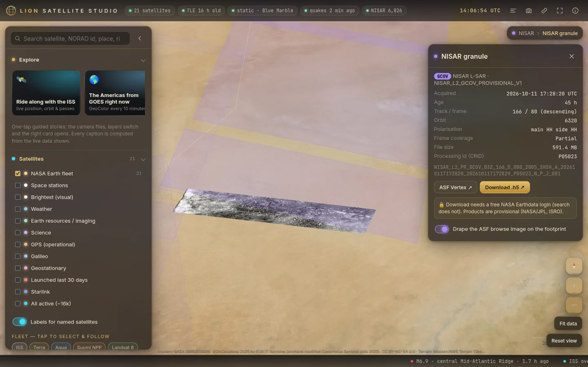 | **Built to explore.** One-tap guided tours (ISS, GOES, fires, SWOT, night, radar, NISAR), search by satellite, NORAD id, place, river or street address (OpenStreetMap, on Enter), time controls (pause, real time, ×10, ×100), a share link that restores the view, PNG capture with credits burned in, and a status line for every source. |

**On a phone** the panel becomes a bottom sheet and every card fits one hand:

<p>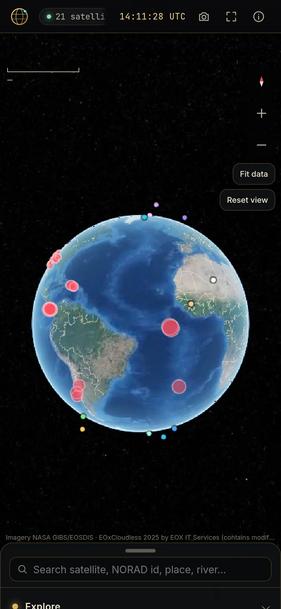 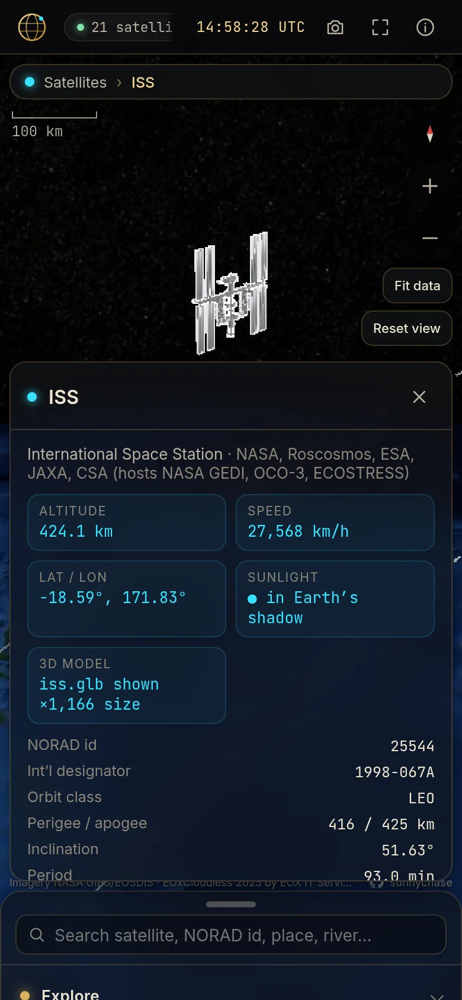 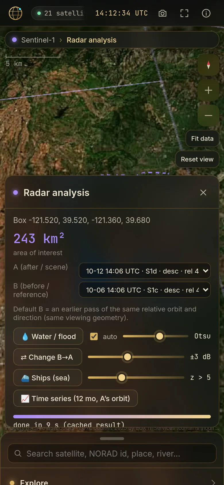</p>

## Point report — what sees this spot?

Type an address or a place (*1 Main St, Springfield* or *Golden Gate Bridge*), coordinates (`37.8199, -122.4783` or
`37°49′11.6″N 122°28′41.9″W`), right-click the globe (long-press on a phone), or tap *My location*, and the app answers **which satellites see that exact point and which data already exist for it**:

<p>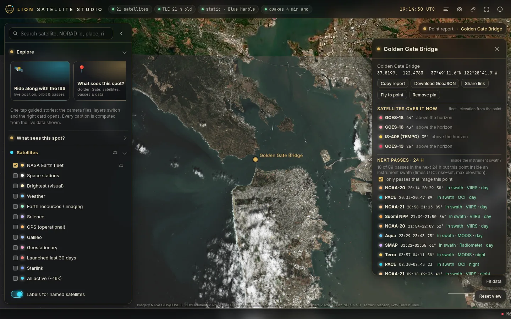 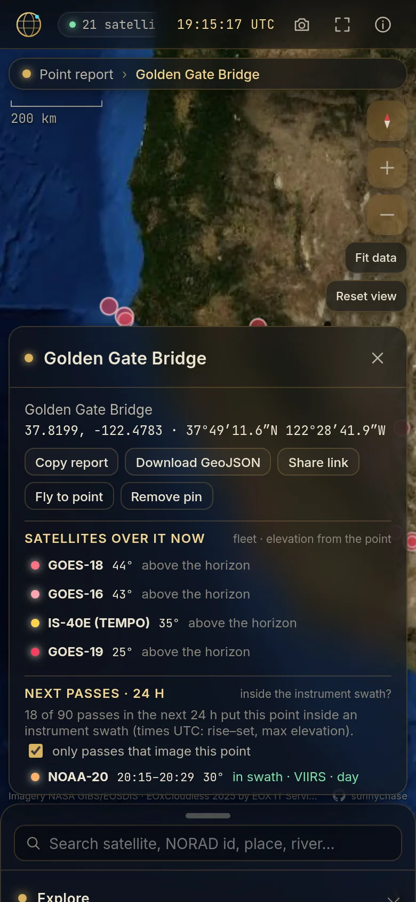</p>

| Section | How it is worked out |
|---|---|
| **Satellites over it now** | Every fleet satellite above the point's horizon, with its elevation angle; *imaging now* when the point lies inside the instrument swath (the swath widths in `missions.json`) within ±100 km of the satellite's current position. With the *All active* group loaded, a count of everything above the horizon. |
| **Next passes (24 or 48 h)** | Rise, peak and set (your time zone and UTC, with compass directions) and the maximum elevation of every pass above 10° of up to 30 satellites: ISS, NISAR, Sentinel-1A/1C/1D, Sentinel-2A/2B/2C, Landsat 8 and 9 and SWOT first, then the rest of the fleet in low orbit, Sentinel-3A/3B, Tiangong and Hubble. A pass is **visible to the eye** when the satellite is in sunlight while the sun is more than 6° below the point's horizon. Computed with SGP4 in a Web Worker, so the page never stalls. |
| **Imaging passes (24 h)** | Rise, set and maximum elevation of each low-orbit fleet satellite, and whether the point falls **inside the instrument swath** at closest approach (cross-track distance vs the swath, nadir gaps included), day or night. This is the "which satellite will have data here" answer. |
| **Daily imagery at this pixel** | One NASA GIBS tile per layer at ~1 km per pixel, read in your browser: MODIS Terra/Aqua and VIIRS (Suomi NPP, NOAA-20, NOAA-21) true colour and the active science layer, for a date you pick. |
| **Sentinel-1 radar** | The newest 15 Sentinel-1 RTC scenes whose footprint contains the point (Planetary Computer STAC point search); tap one to show it. |
| **Optical scenes** | The newest Sentinel-2 L2A, Landsat Collection 2 L2 and HLS (L30, S30) scenes over the point with their cloud cover, and in the US the NAIP aerial photographs (USDA, ~0.6 m) with state and date; tap to show the scene with Planetary Computer's own "Natural color" render. |
| **NISAR** | Every NISAR granule whose footprint contains the point (ASF `intersectsWith=POINT`), by product, with the browse image on tap. |
| **SWOT** | River reaches within 10 km from NASA's SWOT RiverSP feature service (keyless), with the last valid pass and water-surface elevation, plus the nearest curated river or lake. |
| **Nearby** | Earthquakes M2.5+ within 300 km in the last 7 days (USGS) and, with an aisstream.io key, AIS ships within 50 km. |
| **Geostationary views** | Whether GOES-East, GOES-West and Himawari see the point, with the view zenith angle (above 70° is poor). |

Every row flies to the item and switches its layer on. *Copy report* gives Markdown, *Download GeoJSON* the full report, and
*Share link* a URL ending in `#pt=lat,lon`. The server validates the coordinates, rounds them to 4 decimals (about 11 m) for its
cache keys, caches every search for an hour, and accepts a new point from the same client at most once every 3 seconds.

## Golden Gate gallery

Real screenshots of the app looking at the Golden Gate Bridge (37.8199, −122.4783), taken on 2026-10-13 with the app's own data
(headless Chromium, 1440×900 and 390×844). Every image keeps the provider's credit; the one-line attribution at the bottom of each
frame is the app's own, and the full credits are under each picture.

<table>
<tr>
<td width="50%" valign="top">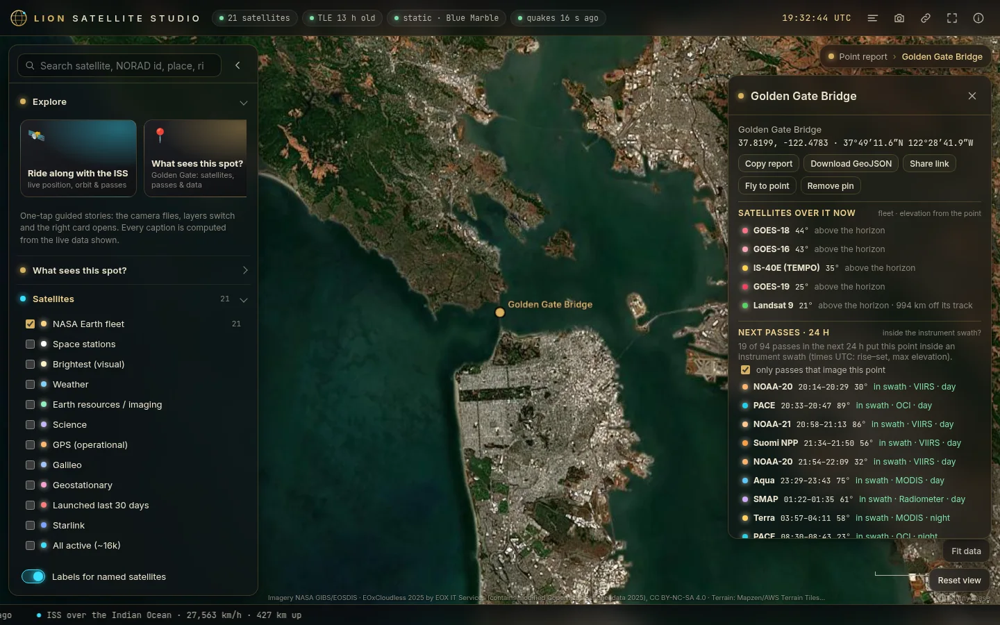<br>
<b>Point report.</b> The satellites over the bridge at 19:32 UTC and the next passes; 19 of the 94 fleet passes in the next 24 h put the bridge inside an instrument swath.<br>
<sub>Orbits: CelesTrak. Background: EOxCloudless 2025 by EOX IT Services (contains modified Copernicus Sentinel data 2025), CC BY-NC-SA 4.0.</sub></td>
<td width="50%" valign="top">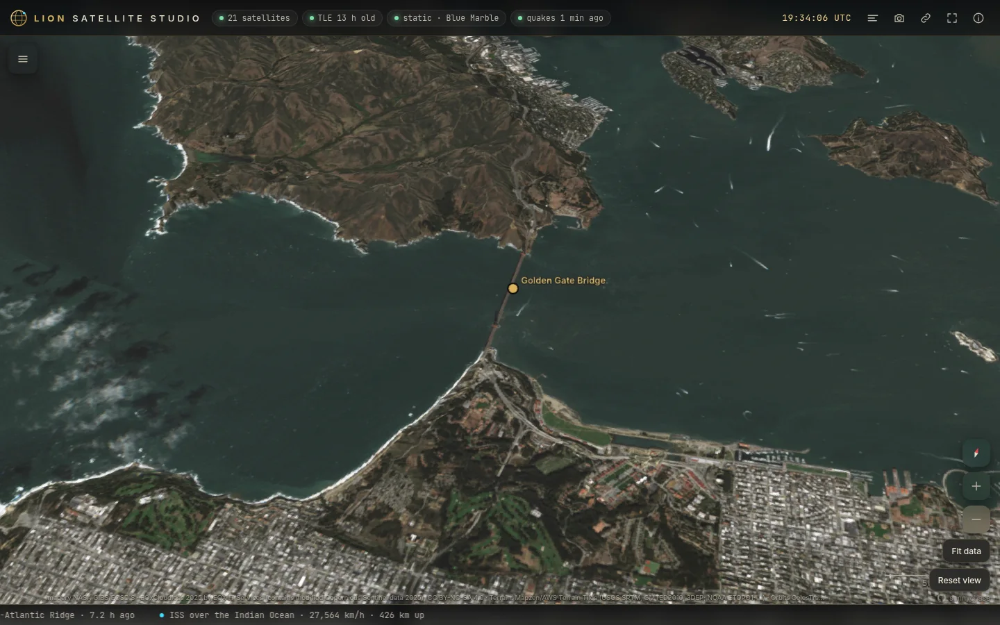<br>
<b>Sentinel-2C MSI, Level-2A, 2026-10-10 18:53 UTC</b>, 5 % cloud (the scene's own estimate); 10 m natural colour (B4, B3, B2), Planetary Computer render, draped on 3D terrain (×1.5) with the Marin Headlands to the north.<br>
<sub>Contains modified Copernicus Sentinel data 2026; via Microsoft Planetary Computer. Terrain: Mapzen / AWS Terrain Tiles.</sub></td>
</tr>
<tr>
<td valign="top">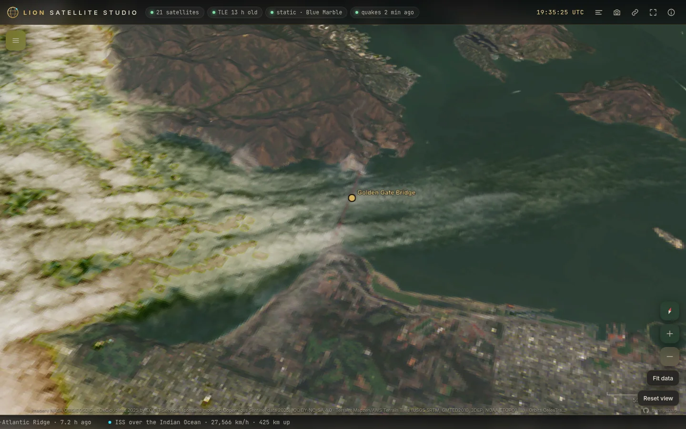<br>
<b>Landsat 9 OLI-2, Collection 2 Level-2, 2026-10-05 18:46 UTC</b>, 33 % cloud: the same view at 30 m, with low cloud and fog over the strait that day.<br>
<sub>Landsat 9 courtesy of the U.S. Geological Survey; via Microsoft Planetary Computer.</sub></td>
<td valign="top">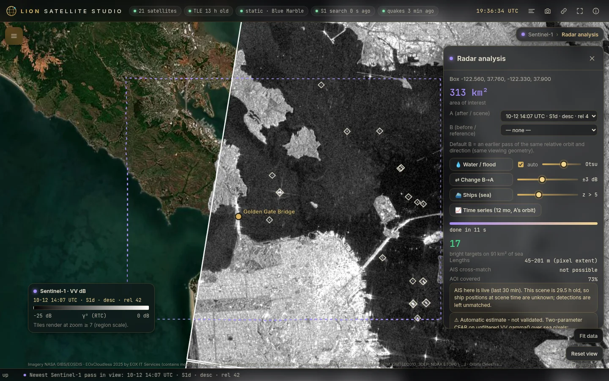<br>
<b>Sentinel-1D C-band radar, IW GRD → RTC γ⁰, VV in dB, 2026-10-12 14:07 UTC</b>, descending, relative orbit 42, 10 m pixels. The scene's edge crosses the box (71 % covered). Ship analysis on a 313 km² box: 17 bright targets on 91 km² of sea (automatic estimate, not validated; AIS cross-match not possible for a 29 h old scene).<br>
<sub>Contains modified Copernicus Sentinel data 2026; RTC by Catalyst, via Microsoft Planetary Computer.</sub></td>
</tr>
<tr>
<td valign="top">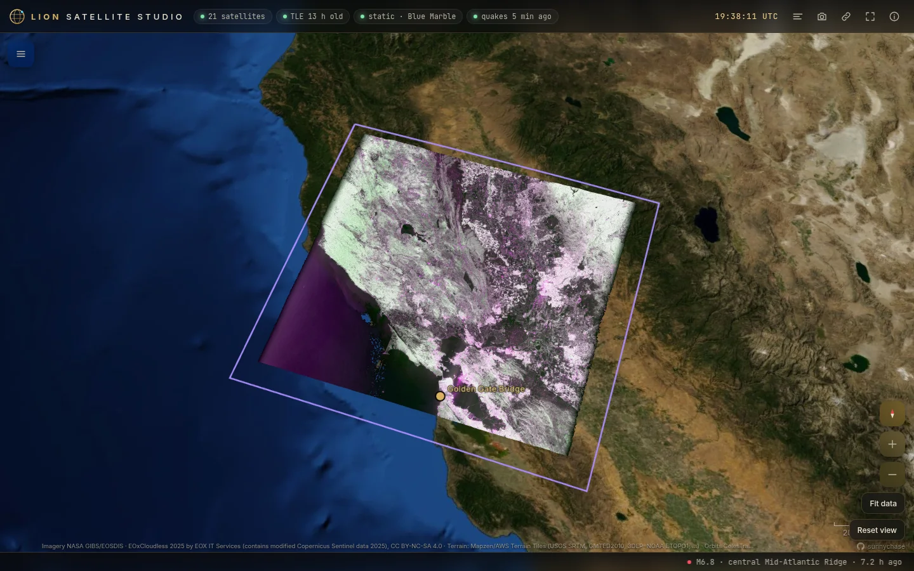<br>
<b>NISAR L-band radar, GCOV (provisional), 2026-10-10 03:04 UTC</b>, track 143, frame 69, descending: footprint and ASF browse image (reduced resolution) covering the bridge.<br>
<sub>NASA/JPL-Caltech, ISRO; ASF DAAC 2026, contains modified NISAR data.</sub></td>
<td valign="top">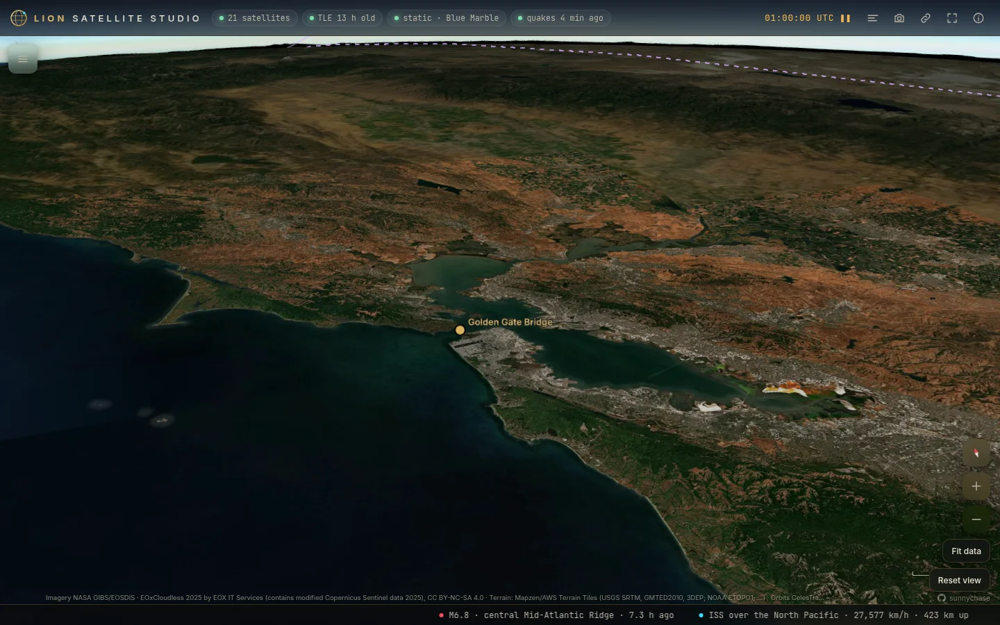<br>
<b>Golden hour.</b> The app's clock set to 2026-10-14 01:00 UTC, when the sun is about 6° above the horizon at the bridge, with day/night lighting and 3D terrain. Dashed: SMAP's upcoming ground track. No PACE or NOAA-20 pass falls in golden hour that day (they cross around 20:15–22:00 UTC).<br>
<sub>EOxCloudless 2025 by EOX IT Services (contains modified Copernicus Sentinel data 2025), CC BY-NC-SA 4.0. Terrain: Mapzen / AWS Terrain Tiles. Orbits: CelesTrak.</sub></td>
</tr>
</table>

<p><br>
<b>USDA NAIP aerial photograph, acquired 2022-05-18</b> (item ca_m_3712213_nw_10_060_20220518, 0.6 m, natural colour), loaded by the app
on its own at 900 m above the strait, looking north-north-west to the Marin Headlands. The straight edge on the right is the end of this
photo (one quarter-quadrangle, about 6 × 7 km); beyond it is the EOxCloudless backdrop.<br>
<sub>USDA NAIP via Microsoft Planetary Computer (public domain). Terrain: Mapzen / AWS Terrain Tiles. Backdrop: EOxCloudless 2025 by EOX IT Services, CC BY-NC-SA 4.0.</sub></p>

<p>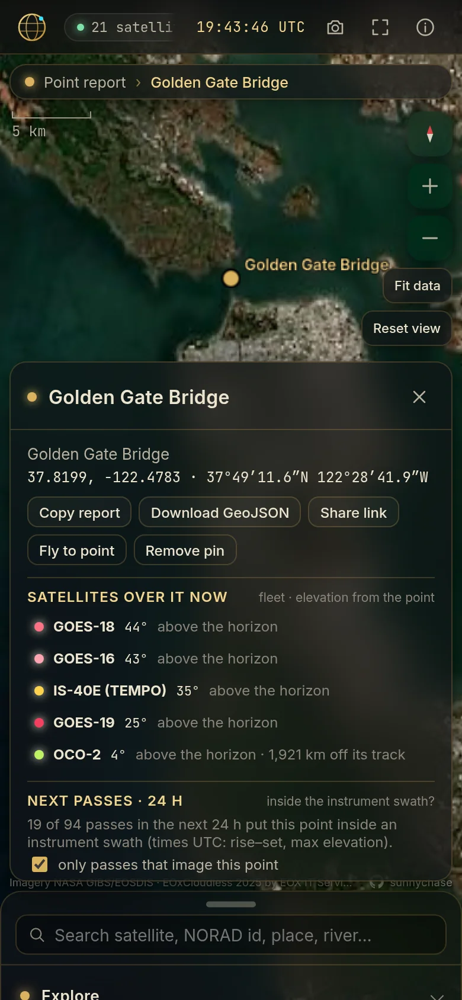<br>
<sub>The Point report on a phone (390×844). Background: EOxCloudless 2025, CC BY-NC-SA 4.0.</sub></p>

## Requirements

| | |
|---|---|
| **Server** | Any Linux or macOS machine that runs Python **3.10+**. No GPU: the server only fetches, caches and serves. Developed on an NVIDIA DGX Spark (aarch64, Ubuntu 24.04, Python 3.12); the code is plain Python with no platform-specific parts. The radar worker is CPU-only: a 243 km² water analysis of Lake Oroville took 13 s on the Spark (one run). |
| **Browser** | A current Chrome, Edge, Firefox or Safari with **WebGL2**. A laptop's integrated graphics is plenty. Phones work (the layout has a bottom-sheet mode; the screenshots above are from a 390×844 phone viewport). |
| **Software** | Core: nothing beyond Python, see [requirements.txt](requirements.txt). Optional radar extras: numpy, scipy, rasterio, pystac, pystac-client, planetary-computer ([requirements-radar.txt](requirements-radar.txt)); `rasterio` wheels bundle GDAL. The aisstream.io feed uses the server's own WebSocket client, so it needs no package. |
| **Disk** | ~35 MB for the repository; the cache grows to a few tens of MB (mostly the NISAR footprint database); radar results are kept 7 days. ~380 MB for the optional radar venv. |
| **Network** | Outbound HTTPS to the providers below. The server listens on `127.0.0.1` by default. |

## Configuration

Settings are environment variables, read from `satellite.env` next to `server.py` if it exists
([template](satellite.env.example)); real environment variables win. Only `LSS_*` keys are read from that file.

| Setting | Default | What it does |
|---|---|---|
| `LSS_HOST` | `127.0.0.1` | Bind address. `0.0.0.0` makes it reachable from your LAN (see the note below). |
| `LSS_PORT` | `8640` | Port. |
| `LSS_CACHE_DIR` | `./cache` | Cached upstream data, the NISAR SQLite database and radar results. |
| `LSS_DATA_DIR` | `./data` | Natural Earth land polygons for the radar ship detector. |
| `LSS_KEYS_FILE` | `./keys.env` | Optional keys (below). |
| `LSS_VENV_PYTHON` | `./venv/bin/python` | Python with the radar extras. Without it, the *Analyse* buttons say the extras are missing; everything else works. |
| `LSS_CONTACT` | empty | Optional contact added to the User-Agent sent to providers, e.g. `LionSatelliteStudio/1.0 (+https://github.com/sunnychase/lion-satellite-studio; https://example.org/contact)`. |
| `LSS_DISABLE_AIS` | `0` | `1` keeps the aisstream.io connection closed even if a key is present. |
| `LSS_GEOCODER` | `1` | `0` switches address search off. |
| `LSS_GEOCODER_URL` | Nominatim | Another Nominatim-compatible `/search` endpoint (https only), e.g. your own instance. |

**Using it from your phone or another computer.** There is no login. On a network you trust, set `LSS_HOST=0.0.0.0` and
open `http://<server-address>:8640`. Anywhere else, keep the default and put it behind an authenticating reverse proxy or
tunnel (for example Tailscale, Cloudflare Access, or nginx with auth). Never expose it bare to the internet.

**Optional keys: ships and dark vessels.** Two layers stay off until you add a key. Write them to the keys file yourself,
readable only by you, and never commit it (`.gitignore` already covers `keys.env*`):

```bash
install -m 600 /dev/null keys.env       # creates an empty file with mode 600 (or the path in LSS_KEYS_FILE)
$EDITOR keys.env
#   AISSTREAM_API_KEY=...   free key from https://aisstream.io  (live AIS ships)
#   GFW_API_TOKEN=...       free token from https://globalfishingwatch.org/our-apis/  (non-commercial use)
# then restart the server
```

The server reads the file once at start, logs only *which* keys are present, never their values, and never sends them to the
browser. `/api/status` shows `present` or `missing` for each.

## The satellites — what each one does

The globe follows these satellites by default (the "NASA Earth fleet"). Tap any of them for the live card.

<!-- satellites:start -->
| Satellite | Agency | Launch | Orbit | Instruments, in plain words | What it measures | In the app |
|---|---|---|---|---|---|---|
| **[International Space Station](https://www.nasa.gov/reference/international-space-station/)**<br><sub>NORAD 25544</sub> | NASA, Roscosmos, ESA, JAXA, CSA (hosts NASA GEDI, OCO-3, ECOSTRESS) | 1998-11-20 | LEO ~370–460 km | **GEDI**: Lidar with 3 lasers making 8 tracks that measure forest canopy height and 3D structure.<br>**OCO-3**: Spectrometer measuring CO2 and plant fluorescence, incl. snapshot maps over cities.<br>**ECOSTRESS**: Thermal radiometer measuring plant temperature to detect water stress (38 m x 69 m pixels). | A crewed orbiting laboratory. Its hosted NASA Earth instruments map forest structure (GEDI), carbon dioxide (OCO-3) and plant water stress (ECOSTRESS) at times of day sun-synchronous satellites miss. | 3D model (NASA 3D Resources) |
| **[Terra (EOS AM-1)](https://terra.nasa.gov/)**<br><sub>NORAD 25994</sub> | NASA | 1999-12-18 | LEO, sun-synchronous ~705 km nominal; lowered ~5 km and drifting to an earlier morning equator crossing (was 10:30 a.m.) | **MODIS**: 36-band imager viewing the whole Earth every 1–2 days: clouds, aerosols, fires, snow, vegetation.<br>**ASTER**: High-resolution (15–90 m) visible and thermal imager; its shortwave-IR channels are unavailable.<br>**MISR**: Nine cameras at different angles measuring aerosols, cloud heights and surface texture.<br>**CERES**: Radiometers measuring reflected sunlight and emitted heat (Earth's energy budget).<br>**MOPITT**: Measures carbon monoxide pollution in the lower atmosphere. | Terra, the EOS flagship, measures land, atmosphere, oceans and Earth's energy balance together, giving a 25+ year record of how the planet is changing and data on fires, volcanoes and other hazards. | MODIS Terra · true colour (daily)<br>Aerosol optical depth · MODIS Terra 3 km<br>Snow cover · MODIS Terra NDSI<br>Clouds · MODIS Terra cloud fraction<br>3D model (NASA 3D Resources) |
| **[Aqua (EOS PM-1)](https://science.nasa.gov/mission/aqua/)**<br><sub>NORAD 27424</sub> | NASA | 2002-05-04 | LEO, sun-synchronous ~705 km as launched (1:30 p.m. crossing); free-drifting since leaving the A-Train in Jan 2022 | **MODIS**: 36-band imager: ocean color, aerosols, clouds, sea-surface temperature, snow and ice.<br>**AIRS**: Infrared sounder profiling atmospheric temperature and water vapor.<br>**AMSU-A**: Microwave sounder measuring temperature through clouds.<br>**CERES**: Radiometers measuring reflected sunlight and emitted heat (Earth's energy budget).<br>**AMSR-E**: Microwave radiometer (rain, sea ice, soil moisture); off since March 2016.<br>**HSB**: Humidity sounder (Brazil); non-operational since a February 2003 anomaly. | Aqua (Latin for water) tracks Earth's water cycle: evaporation, water vapor, clouds, rain, sea ice, snow and ocean color, plus aerosols and the planet's energy balance, over 20+ years. | Chlorophyll-a · MODIS Aqua<br>MODIS_Aqua_Aerosol_Optical_Depth_3km<br>MODIS Aqua · true colour (daily)<br>3D model (NASA 3D Resources) |
| **[Suomi NPP (Suomi National Polar-orbiting Partnership)](https://science.nasa.gov/mission/suomi-npp/)**<br><sub>NORAD 37849</sub> | NOAA/NASA | 2011-10-28 | LEO, sun-synchronous ~833 km, 1:25 p.m. ascending node | **VIIRS**: Visible/infrared imager: clouds, fires, snow, ocean color, aerosols and night lights.<br>**ATMS**: Microwave sounder that sees through clouds to profile atmospheric temperature and moisture.<br>**CrIS**: Infrared sounder with thousands of channels for 3D temperature and humidity profiles.<br>**OMPS**: Ozone mapper and profiler tracking the ozone layer, volcanic SO2 and stratospheric aerosols.<br>**CERES**: Radiometer measuring sunlight reflected and heat emitted by Earth (the energy budget). | Bridges NASA's EOS era and NOAA's JPSS weather satellites, observing clouds, oceans, vegetation, ice and the atmosphere for weather forecasts and long-term climate records, including night-time light imagery. | VIIRS Suomi NPP · true colour (daily)<br>VIIRS Suomi NPP fires 375 m<br>Night lights · VIIRS day/night band (nightly)<br>Aerosol optical depth · VIIRS Suomi NPP<br>3D model (NASA 3D Resources) |
| **[NOAA-20 (JPSS-1)](https://www.nesdis.noaa.gov/our-satellites/currently-flying/joint-polar-satellite-system)**<br><sub>NORAD 43013</sub> | NOAA/NASA | 2017-11-18 | LEO, sun-synchronous ~833 km, 1:25 p.m. ascending node | **VIIRS**: Visible/infrared imager: clouds, fires, snow, ocean color, aerosols and night lights.<br>**ATMS**: Microwave sounder that sees through clouds to profile atmospheric temperature and moisture.<br>**CrIS**: Infrared sounder with thousands of channels for 3D temperature and humidity profiles.<br>**OMPS**: Ozone mapper and profiler tracking the ozone layer, volcanic SO2 and stratospheric aerosols.<br>**CERES**: Radiometer measuring sunlight reflected and heat emitted by Earth (the energy budget). | A NOAA polar weather satellite circling pole to pole 14 times a day. Its temperature and moisture soundings feed forecast models, and its imagery tracks storms, fires, snow, ice and ocean color. | VIIRS NOAA-20 · true colour (daily)<br>VIIRS NOAA-20 fires 375 m<br>3D model (NASA 3D Resources) |
| **[NOAA-21 (JPSS-2)](https://www.nesdis.noaa.gov/our-satellites/currently-flying/joint-polar-satellite-system)**<br><sub>NORAD 54234</sub> | NOAA/NASA | 2022-11-10 | LEO, sun-synchronous (~833 km JPSS orbit), 1:25 p.m. ascending node | **VIIRS**: Visible/infrared imager: clouds, fires, snow, ocean color, aerosols and night lights.<br>**ATMS**: Microwave sounder that sees through clouds to profile atmospheric temperature and moisture.<br>**CrIS**: Infrared sounder with thousands of channels for 3D temperature and humidity profiles.<br>**OMPS**: Ozone mapper and profiler tracking the ozone layer, volcanic SO2 and stratospheric aerosols. | NOAA's newest polar weather satellite: global temperature and moisture soundings for forecasts, plus imagery of storms, fires, floods, snow and ice, and ozone monitoring. | VIIRS NOAA-21 · true colour (daily)<br>VIIRS NOAA-21 fires 375 m<br>3D model (NASA 3D Resources) |
| **[Landsat 8](https://www.usgs.gov/landsat-missions/landsat-8)**<br><sub>NORAD 39084</sub> | NASA/USGS | 2013-02-11 | LEO, sun-synchronous ~705 km, 10:12 a.m. equator crossing, 16-day repeat (8-day offset from Landsat 9) | **OLI**: Operational Land Imager: 30 m visible/near-IR/shortwave-IR imagery (15 m panchromatic).<br>**TIRS**: Thermal Infrared Sensor: 100 m land-surface temperature imagery. | Images Earth's land at 30 m detail, continuing a record that began in 1972, to track farms, forests, cities, water and disasters over decades. | HLS Landsat 30 m · recent detailed<br>3D model (NASA 3D Resources) |
| **[Landsat 9](https://www.usgs.gov/landsat-missions/landsat-9)**<br><sub>NORAD 49260</sub> | NASA/USGS | 2021-09-27 | LEO, sun-synchronous ~705 km, 10:12 a.m. equator crossing, 16-day repeat (8-day offset from Landsat 8) | **OLI-2**: Operational Land Imager 2: 30 m visible/near-IR/shortwave-IR imagery, 14-bit data.<br>**TIRS-2**: Thermal Infrared Sensor 2: 100 m land-surface temperature imagery. | Extends the 50+ year Landsat record of Earth's land. Paired with Landsat 8 it revisits each place every 8 days, aiding deforestation, water-quality and crop monitoring. | HLS Landsat 30 m · recent detailed<br>3D model (NASA 3D Resources) |
| **[GPM Core Observatory (Global Precipitation Measurement)](https://gpm.nasa.gov/missions/GPM)**<br><sub>NORAD 39574</sub> | NASA/JAXA | 2014-02-27 | LEO, non-sun-synchronous, 65° inclination, ~408 km (397–419 km) | **DPR**: Dual-frequency (Ku/Ka) precipitation radar giving 3D views of rain and snow inside storms.<br>**GMI**: 13-channel microwave imager measuring rain and snowfall across a wide swath. | Measures rain and snow worldwide and calibrates an international satellite constellation that maps rain and snow worldwide every three hours, supporting flood, hurricane and drought forecasting. | Precipitation · GPM IMERG (daily)<br>GPM IMERG · precipitation (30 min)<br>3D model (NASA 3D Resources) |
| **[SMAP (Soil Moisture Active Passive)](https://smap.jpl.nasa.gov/)**<br><sub>NORAD 40376</sub> | NASA | 2015-01-31 | LEO, sun-synchronous dawn/dusk ~685 km (6 p.m. ascending node), 8-day repeat | **L-band radiometer**: Senses natural microwave emission from soil to map moisture and freeze/thaw.<br>**L-band radar**: Higher-resolution active sensor; failed in July 2015.<br>**6 m rotating antenna**: Spinning mesh reflector (14.6 rpm) that sweeps a wide conical swath. | Maps how wet the top few centimeters of soil are and whether ground is frozen or thawed every 2–3 days, improving flood, drought, crop and weather forecasts. | Soil moisture · SMAP L4 surface<br>Soil moisture · SMAP L3 (AM pass)<br>generic 3D model |
| **[ICESat-2 (Ice, Cloud, and land Elevation Satellite-2)](https://icesat-2.gsfc.nasa.gov/)**<br><sub>NORAD 43613</sub> | NASA | 2018-09-15 | LEO ~500 km (310 mi), 92° inclination, 91-day repeat | **ATLAS**: Green (532 nm) photon-counting laser altimeter: 10,000 pulses/s split into six beams in three pairs. | Measures the height of ice sheets, glaciers, sea ice, forests and water with a laser, showing how fast Earth's ice is thinning and how much it adds to sea-level rise. | 3D model (NASA 3D Resources) |
| **[GRACE-FO (Gravity Recovery and Climate Experiment Follow-On)](https://gracefo.jpl.nasa.gov/)**<br><sub>NORAD 43476, 43477</sub> | NASA/GFZ | 2018-05-22 | LEO, near-polar (~89° incl.) ~490 km; twin satellites ~220 km apart in the same orbit | **KBR (MWI)**: K/Ka-band microwave link measuring tiny changes in the distance between the two satellites.<br>**LRI**: Laser Ranging Interferometer: lower-noise laser measurement of the inter-satellite distance.<br>**ACC**: Accelerometer separating non-gravitational forces (air drag, sunlight) from gravity.<br>**TriG GNSS / SCA**: GNSS receiver and star cameras for precise position and orientation. | Tracks month-to-month changes in Earth's gravity caused by moving water and ice: shrinking ice sheets, groundwater depletion, drought and sea-level change. The two satellites act as one instrument. | 3D model (NASA 3D Resources) |
| **[SWOT (Surface Water and Ocean Topography)](https://swot.jpl.nasa.gov/)**<br><sub>NORAD 54754</sub> | NASA/CNES | 2022-12-16 | LEO, non-sun-synchronous ~891 km, 78° inclination, ~21-day repeat (science orbit since July 2023) | **KaRIn**: Ka-band radar interferometer on a 10 m boom mapping water heights in two wide swaths.<br>**Nadir altimeter**: Conventional radar altimeter measuring sea level straight below (fills the gap).<br>**Microwave radiometer**: Measures water vapor to correct the radar height measurements.<br>**DORIS / GPS / LRA**: Precise orbit determination so heights can be measured to centimeters. | First global survey of Earth's surface water: heights of rivers, lakes and reservoirs and fine-scale ocean surface topography, showing how water bodies change and how eddies move heat. | SWOT river & lake heights (PO.DAAC Hydrocron)<br>generic 3D model |
| **[OCO-2 (Orbiting Carbon Observatory-2)](https://ocov2.jpl.nasa.gov/)**<br><sub>NORAD 40059</sub> | NASA | 2014-07-02 | LEO, sun-synchronous near-polar ~705 km, ~1:30 p.m. ascending node, 16-day repeat | **Three-band grating spectrometer**: Reads sunlight absorbed by CO2 and O2 to measure column CO2 and plant fluorescence. | Measures carbon dioxide in the air column with high precision to find where CO2 is emitted and absorbed by forests, oceans and soils, and tracks plant photosynthesis via fluorescence. | 3D model (NASA 3D Resources) |
| **[PACE (Plankton, Aerosol, Cloud, ocean Ecosystem)](https://pace.gsfc.nasa.gov/)**<br><sub>NORAD 58928</sub> | NASA | 2024-02-08 | LEO, polar ~676 km, 98° inclination | **OCI**: Ocean Color Instrument: hyperspectral UV-to-shortwave-IR scanner revealing plankton types.<br>**SPEXone**: Narrow-swath multi-angle polarimeter characterizing aerosol particles.<br>**HARP2**: Wide-swath hyper-angular polarimeter studying clouds and aerosols. | Measures ocean color to identify phytoplankton communities, and studies aerosols and clouds, to monitor ocean health, air quality and climate. | Chlorophyll-a · PACE OCI<br>PACE OCI · true colour (daily)<br>generic 3D model |
| **[NISAR (NASA-ISRO Synthetic Aperture Radar)](https://science.nasa.gov/mission/nisar/)**<br><sub>NORAD 65053</sub> | NASA/ISRO | 2025-07-30 | LEO, sun-synchronous dawn/dusk ~747 km, 98.4° inclination, 12-day exact repeat | **L-SAR**: NASA 24 cm L-band radar that sees through clouds and vegetation; 12 m mesh reflector.<br>**S-SAR**: ISRO 9.4 cm S-band radar sharing the reflector, sensitive to crops and surface detail. | Radar maps of land and ice every 12 days, day or night through clouds, measuring ground motion from earthquakes and volcanoes, glacier flow, crop and forest change, and flooding. | NISAR footprints (ASF)<br>generic 3D model |
| **[GOES-16 (GOES-R)](https://www.nesdis.noaa.gov/our-satellites/currently-flying/geostationary-satellites)**<br><sub>NORAD 41866</sub> | NOAA/NASA | 2016-11-19 | GEO, on-orbit storage at 104.7°W (as of June 2025) | **ABI**: Advanced Baseline Imager: 16-band visible/IR imager scanning the full disk every few minutes.<br>**GLM**: Geostationary Lightning Mapper: maps lightning flashes continuously, day and night.<br>**SUVI**: Solar Ultraviolet Imager: watches the Sun's corona for flares and eruptions.<br>**EXIS**: Measures solar extreme-ultraviolet and X-ray output (flare detection).<br>**SEISS**: Measures charged particles around the satellite (space-weather radiation).<br>**MAG**: Magnetometer measuring Earth's magnetic field at geostationary orbit. | Former GOES-East weather satellite (2017–2025). It is kept in storage as a backup, ready to replace GOES-18 or GOES-19 if one fails. | 3D model (NASA 3D Resources) |
| **[GOES-18 (GOES-T) — operational GOES-West](https://www.nesdis.noaa.gov/our-satellites/currently-flying/geostationary-satellites)**<br><sub>NORAD 51850</sub> | NOAA/NASA | 2022-03-01 | GEO 137.0°W (GOES-West since 2023-01-04) | **ABI**: Advanced Baseline Imager: 16-band visible/IR imager scanning the full disk every few minutes.<br>**GLM**: Geostationary Lightning Mapper: maps lightning flashes continuously, day and night.<br>**SUVI**: Solar Ultraviolet Imager: watches the Sun's corona for flares and eruptions.<br>**EXIS**: Measures solar extreme-ultraviolet and X-ray output (flare detection).<br>**SEISS**: Measures charged particles around the satellite (space-weather radiation).<br>**MAG**: Magnetometer measuring Earth's magnetic field at geostationary orbit. | Watches the Pacific, western North America and Hawaii from a fixed spot, imaging storms, wildfire smoke, fog and lightning every few minutes, and monitoring space weather. | GOES-West · GeoColor<br>GOES-West · clean IR (band 13)<br>GOES-West · red visible (band 2)<br>GOES-West · air mass RGB<br>GOES-West · fire temperature RGB<br>3D model (NASA 3D Resources) |
| **[GOES-19 (GOES-U) — operational GOES-East](https://www.nesdis.noaa.gov/our-satellites/currently-flying/geostationary-satellites)**<br><sub>NORAD 60133</sub> | NOAA/NASA | 2024-06-25 | GEO 75.2°W (GOES-East since 2025-04-07) | **ABI**: Advanced Baseline Imager: 16-band visible/IR imager scanning the full disk every few minutes.<br>**GLM**: Geostationary Lightning Mapper: maps lightning flashes continuously, day and night.<br>**SUVI**: Solar Ultraviolet Imager: watches the Sun's corona for flares and eruptions.<br>**EXIS**: Measures solar extreme-ultraviolet and X-ray output (flare detection).<br>**SEISS**: Measures charged particles around the satellite (space-weather radiation).<br>**MAG**: Magnetometer measuring Earth's magnetic field at geostationary orbit.<br>**CCOR**: Compact Coronagraph: images solar eruptions (CMEs) heading toward Earth. | Watches the Americas and Atlantic from a fixed spot, imaging hurricanes, severe storms, fires and lightning every few minutes; its coronagraph adds early warning of solar storms. | GOES-East · GeoColor<br>GOES-East · clean IR (band 13)<br>GOES-East · red visible (band 2)<br>GOES-East · air mass RGB<br>GOES-East · fire temperature RGB<br>3D model (NASA 3D Resources) |
| **[Intelsat 40e (IS-40e) — host of NASA TEMPO](https://science.nasa.gov/mission/tempo/)**<br><sub>NORAD 56174</sub> | Intelsat (hosts NASA TEMPO) | 2023-04-07 | GEO ~91°W (planned TEMPO position per eoPortal) | **TEMPO**: NASA UV-visible spectrometer measuring air pollution over North America every daylight hour. | A commercial communications satellite carrying NASA's TEMPO, which maps ozone, nitrogen dioxide, aerosols and other pollutants hourly across North America at neighborhood scale. | NO₂ (troposphere) · TEMPO, North America<br>generic 3D model |

<sub>Generated by `scripts/gen_satellites_table.py` from `static/data/missions.json` (facts checked against the pages listed in its `sources`, as of 2026-10-13; anything that could not be confirmed is left out), the layer list in `server.py` and the model list in `static/js/sats.js`. Every satellite also gets its live position, orbit track, passes over you and, where known, its instrument swath.</sub>
<!-- satellites:end -->

## Data sources and licences

Everything shown comes from the providers below, each under its own terms. The page's **About** box and every PNG capture
carry the attributions. The code's MIT licence does not cover the data.

| Source | Used for | Terms |
|---|---|---|
| [CelesTrak](https://celestrak.org) (T.S. Kelso) | orbital elements (GP data) | Free. CelesTrak asks clients to download each group **no more than once every 2 hours**; the server caches each group for 2 h 2 min and keeps the cache when CelesTrak says the data has not changed. |
| [NASA GIBS / EOSDIS](https://nasa-gibs.github.io/gibs-api-docs/) | imagery, science layers, GOES/Himawari frames, fires | NASA data, no restrictions on use. Acknowledgement: "We acknowledge the use of imagery provided by services from NASA's Global Imagery Browse Services (GIBS), part of NASA's Earth Science Data and Information System (ESDIS)." |
| [USGS earthquake feeds](https://earthquake.usgs.gov/earthquakes/feed/) | earthquakes | Public domain (U.S. Geological Survey). |
| [NASA FIRMS](https://www.earthdata.nasa.gov/data/tools/firms) public 24-hour CSVs (VIIRS 375 m, Suomi NPP / NOAA-20 / NOAA-21) | active-fire points | NASA data, free and open; no key for these files. Acknowledgement: "We acknowledge the use of data and/or imagery from NASA's Fire Information for Resource Management System (FIRMS) (https://www.earthdata.nasa.gov/data/tools/firms), part of NASA's Earth Science Data and Information System (ESDIS)." Near-real-time detections, not validated; the server fetches each file at most once every 45 minutes. |
| [ASF DAAC](https://asf.alaska.edu) SearchAPI | NISAR footprints and browse images | NASA data, free and open. Cite "ASF DAAC 2026, contains modified NISAR data" (NASA/JPL-Caltech, ISRO). Products are provisional; downloads need a free NASA Earthdata login. |
| [PO.DAAC Hydrocron](https://podaac.github.io/hydrocron/) | SWOT river and lake heights | NASA data, free and open (NASA/JPL, CNES). Values are provisional and are reprocessed under new version letters (CRID). |
| [Microsoft Planetary Computer](https://planetarycomputer.microsoft.com) · Copernicus Sentinel-1 | radar search, tiles and analysis | "Contains modified Copernicus Sentinel data [2025–2026]" under the [Copernicus Sentinel data legal notice](https://sentinel.esa.int/documents/247904/690755/Sentinel_Data_Legal_Notice) (free, full and open). The RTC product (processed by Catalyst) is CC BY 4.0; access is under the [Planetary Computer terms of use](https://planetarycomputer.microsoft.com/terms), with anonymous short-lived tokens. |
| [Sentinel-2 L2A](https://planetarycomputer.microsoft.com/dataset/sentinel-2-l2a) via Planetary Computer | Point report: optical scenes | "Contains modified Copernicus Sentinel data [2025–2026]", Copernicus Sentinel data legal notice (free, full and open). |
| [Landsat Collection 2 Level-2](https://planetarycomputer.microsoft.com/dataset/landsat-c2-l2) via Planetary Computer | Point report: optical scenes | Courtesy of the U.S. Geological Survey; public domain. |
| [HLS v2.0](https://planetarycomputer.microsoft.com/dataset/hls2-l30) (L30, S30) via Planetary Computer | Point report: optical scenes | NASA LP DAAC; free and open (contains modified Copernicus Sentinel data for S30). |
| [NASA Earthdata GIS](https://gis.earthdata.nasa.gov) SWOT RiverSP reach service | Point report: SWOT reaches near a point | NASA/JPL, CNES; free and open, keyless. Values are provisional. |
| [ESA WorldCover 2021 v200](https://esa-worldcover.org) | land mask for ship detection | "© ESA WorldCover project 2021 / Contains modified Copernicus Sentinel data (2021) processed by ESA WorldCover consortium", **CC BY 4.0**. |
| [EOxCloudless 2025](https://cloudless.eox.at) (EOX IT Services) | hi-res backdrop when zoomed in | "EOxCloudless https://cloudless.eox.at by EOX IT Services GmbH (Contains modified Copernicus Sentinel data 2025)", **CC BY-NC-SA 4.0: non-commercial use only.** For commercial use, switch off *Hi-res backdrop* under *Imagery & terrain* (or remove it from `static/js/imagery.js`). |
| [Mapzen / AWS Terrain Tiles](https://registry.opendata.aws/terrain-tiles/) | 3D terrain | Open data from many sources (SRTM, GMTED2010, 3DEP, ETOPO1, EU-DEM, ArcticDEM and national agencies); the full attribution list is in the page's About box. |
| [NAIP](https://planetarycomputer.microsoft.com/dataset/naip) (USDA National Agriculture Imagery Program) via Planetary Computer | aerial photos when zoomed in over the US; Point report | USDA Farm Production and Conservation Business Center; public domain. Credited as "USDA NAIP via Microsoft Planetary Computer"; access under the [Planetary Computer terms of use](https://planetarycomputer.microsoft.com/terms). |
| [OpenStreetMap Nominatim](https://nominatim.org) | address search | Data © OpenStreetMap contributors, [ODbL](https://www.openstreetmap.org/copyright). Used within the [Nominatim usage policy](https://operations.osmfoundation.org/policies/nominatim/): a search is sent only when you press Enter (no autocomplete), at most one request per second for the whole server, with an identifying User-Agent, and every answer is cached for 30 days. Queries go to the OpenStreetMap Foundation; don't search for private addresses you would not share. Switch it off or point it elsewhere with `LSS_GEOCODER` / `LSS_GEOCODER_URL`. |
| [Natural Earth](https://www.naturalearthdata.com) | borders, gazetteer, land mask | Public domain. Made with Natural Earth. |
| [aisstream.io](https://aisstream.io) (your key) | live AIS ships | Free API key. aisstream.io's documentation: "Direct browser connections are not permitted; proxy only the information your clients need from your own server." This server holds the single WebSocket and the key, and the page only sees the server's answers. No terms-of-use page was found; treat the data as for personal, non-commercial viewing. |
| [Global Fishing Watch](https://globalfishingwatch.org) (your token) | radar detections of vessels without AIS | "Powered by Global Fishing Watch." API data under CC BY-NC 4.0: **non-commercial use only**; the token is issued for non-commercial use. |
| NASA 3D Resources | satellite models | See [NOTICE.md](NOTICE.md). |

Third-party software (CesiumJS, satellite.js, fonts) and every 3D model are credited in [NOTICE.md](NOTICE.md).

## Limits and caveats

Honest notes from building and testing it:

- **Radar results are automatic estimates, not validated.** Every result says so, with the method and thresholds used.
- **Open water uses an automatic threshold.** Otsu's method on the box's VV histogram, clamped to −24 … −15 dB (−18 dB if there
  are too few valid pixels). Wind-roughened water, wet snow, radar shadow and very small boxes can fool it; you can set the
  threshold by hand.
- **Ship detection finds bright targets, not ships.** Wind turbines, platforms and buoys appear too. Natural Earth's coastline
  predates recent land reclamation, which is why ESA WorldCover is used as a second land mask.
- **AIS cross-matching is usually not possible.** The AIS feed here is live (last 30 minutes), and Sentinel-1 scenes reach
  Planetary Computer hours after acquisition, so ship positions at scene time are unknown and detections stay unmatched. The
  result says so instead of guessing. A missing AIS message is not proof of a "dark" vessel.
- **Planetary Computer access is anonymous.** It uses short-lived SAS tokens with no subscription key. Microsoft may rate-limit
  anonymous use or require an account later; if tokens are refused, the analysis reports it and stops.
- **NAIP aerial photos are not current.** Each state is flown every 2–3 years in the growing season, so the photo is often 1–3
  years old (its date is in the status bar); it covers the US only (lower 48, Hawaii, Puerto Rico), and one photo is shown at a time,
  so its edge can show at the side of the view.
- **NISAR and SWOT products are provisional** and are reprocessed; values can change.
- **Satellite positions** come from SGP4 and elements up to a day or two old: good to a few kilometres for most low-Earth
  orbiters, not for precision work. Some 3D models are stand-ins (Landsat 9 uses Landsat 8's; GRACE for GRACE-FO; a generic
  model for SMAP, SWOT, PACE, NISAR and Intelsat 40e), and all are drawn far larger than life so you can see them.
- **Fire points are near-real-time detections.** A dot is a thermal anomaly in one ~375 m pixel (vegetation fires, but also
  gas flares, volcanoes and industry); clouds and small or brief fires are missed. Only the newest 60,000 of the day's
  detections are drawn (20,000 on phones and in low-memory mode).
- **Sensor looks are colour filters.** *Thermal* maps the brightness of the picture to an ironbow palette; it is not a
  temperature measurement.
- **Gliding ships are estimates.** Between AIS reports a moving ship is drawn along its last course at its last speed, for at
  most 12 s past the newest data and only for reports less than 2 minutes old; the card always shows the reported position.
- **City lights** are the Black Marble 2016 composite or the latest nightly VIIRS pass, not a live picture.
- **"Passes over me"** uses your browser's location, which browsers only allow on `https://` or `localhost`; elsewhere, type a place.
- **No login.** See [Configuration](#configuration) before opening it to a network.

## FAQ

<details>
<summary><b>Do I need any account or API key?</b></summary>

No. Everything except two optional layers is keyless. Ships (aisstream.io) and dark vessels (Global Fishing Watch) need free
keys you add to the server's keys file. Downloading NISAR products themselves (not their footprints) needs a free NASA
Earthdata login, which this app does not handle.
</details>

<details>
<summary><b>The page is slow, or the panel goes blank, on my machine</b></summary>

Reload once (the page also offers *Reload* when a newer version is on the server). On a busy or small GPU, or a machine whose
memory is shared with other big jobs, switch on **Low-memory mode** under *Imagery & terrain*: it shows fewer NISAR footprints
and ships, drops 3D models, terrain and the hi-res backdrop, and uses a lighter tile cache. It also switches on by itself after a
graphics reset or when frames stay slow.
</details>

<details>
<summary><b>Does it need a GPU?</b></summary>

Not on the server. The browser draws the globe with WebGL2, which any recent laptop or phone does. Even software rendering
works, slowly: the screenshots here were taken in headless Chromium with software WebGL.
</details>

<details>
<summary><b>Why a server at all? Could it be a static page?</b></summary>

The imagery tiles could, but CelesTrak asks for at most one download per group every 2 hours, aisstream.io does not allow browser
connections, ASF and Hydrocron are best queried politely and cached, and the radar analysis needs numpy and rasterio. A
small server that caches once for every viewer is the polite way to use these services.
</details>

<details>
<summary><b>Can I use it commercially?</b></summary>

The code is MIT. Most data is open (NASA, NOAA, USGS, Copernicus), but the EOX hi-res backdrop and Global Fishing Watch are
**non-commercial** (CC BY-NC-SA 4.0 and CC BY-NC 4.0); switch the backdrop off and leave the GFW token out. NASA's insignia
may not be used to suggest endorsement. Check each provider's terms in [Data sources and licences](#data-sources-and-licences).
</details>

<details>
<summary><b>How fresh is the data?</b></summary>

GOES and Himawari frames every 10 minutes (as GIBS publishes them), earthquakes within 5 minutes, NISAR footprints hourly,
daily layers once a day, orbital elements every 2 hours at most, SWOT every 12 hours. The status chips at the top show each
source's age.
</details>

<details>
<summary><b>How much does it ask of the providers?</b></summary>

Little. Each source is fetched by the server on a fixed schedule or on demand, cached on disk, and shared by every viewer;
Hydrocron and Global Fishing Watch get one request at a time; NISAR polling starts only once someone opens that layer.
`/api/status` counts every upstream request.
</details>

<details>
<summary><b>Can I find out which satellite has data for my exact coordinates?</b></summary>

Yes: that is the Point report. Type the coordinates in *What sees this spot?* or the search bar, or right-click the globe. It lists the
satellites over the point now, the passes in the next 24 hours that put the point inside an instrument swath, and the scenes and
products that already exist there (GIBS, Sentinel-1, Sentinel-2, Landsat, HLS, NISAR, SWOT).
</details>

<details>
<summary><b>Can I add another satellite or layer?</b></summary>

Yes. Satellites: add the NORAD id to `FLEET` in `server.py` and `static/js/sats.js`, and its facts (with sources) to
`static/data/missions.json`, then run `python3 scripts/gen_satellites_table.py`. GIBS layers: add an entry to `GIBS_LAYERS` in
`server.py`; it is checked against GIBS GetCapabilities at run time. See [CONTRIBUTING.md](CONTRIBUTING.md).
</details>

## Roadmap

- **NISAR GCOV backscatter tiles** and **GUNW** interferograms, with a NASA Earthdata login.
- **InSAR ground deformation** on demand through ASF HyP3 (Sentinel-1 pairs), with a NASA Earthdata login.
- **FIRMS archive** and MODIS / Landsat fire points beyond the last 24 hours (FIRMS API, needs a free MAP_KEY).
- Copernicus Data Space / Sentinel Hub imagery (needs an account).
- A sky view for Hubble, JWST and the Sun (SDO, SOHO).

Ideas and pull requests are welcome: see [Contributing](#contributing).

## Repository

```
server.py                 the web server and cached proxies: one file, standard library only
analysis.py               optional Sentinel-1 analysis worker (numpy, scipy, rasterio, planetary-computer)
static/                   the page: index.html, css/, js/ (ES modules), data/ (missions, SWOT list, gazetteer, borders),
                          models/ (NASA 3D models + manifest), fonts/, vendor/ (CesiumJS 1.146, satellite.js 7.1)
data/                     Natural Earth 10 m land and minor islands (land mask for ship detection)
scripts/                  check.sh (the CI checks), precompress.py, setup_radar.sh, gen_satellites_table.py
systemd/                  example user unit
docs/images/              logo and screenshots
docs/media/               the 81 s product video (MP4) and the README preview loop
satellite.env.example     every setting, with comments
```

## Contributing

Bug reports and focused pull requests are welcome: [open an issue](https://github.com/sunnychase/lion-satellite-studio/issues)
or [send a pull request](https://github.com/sunnychase/lion-satellite-studio/pulls). Keep machine-specific settings in
`satellite.env`, never in the code, and keep the server standard-library only. [CONTRIBUTING.md](CONTRIBUTING.md) covers running
a development copy and the checks (`bash scripts/check.sh`); [AGENTS.md](AGENTS.md) is a short guide for coding agents. Report
security problems privately, as described in [SECURITY.md](SECURITY.md). Changes are listed in [CHANGELOG.md](CHANGELOG.md).

If the project is useful to you, you can support it with a [donation](https://donate.stripe.com/fZuaER2Cbecw7cQ6PlfEk00).

## Star history

<a href="https://www.star-history.com/#sunnychase/lion-satellite-studio&Date">
  <picture>
    <source media="(prefers-color-scheme: dark)" srcset="https://api.star-history.com/svg?repos=sunnychase/lion-satellite-studio&type=Date&theme=dark">
    <source media="(prefers-color-scheme: light)" srcset="https://api.star-history.com/svg?repos=sunnychase/lion-satellite-studio&type=Date">
    
  </picture>
</a>

## Credits

Created by **[Sunny Chase](https://github.com/sunnychase)** in collaboration with **Claude** (Anthropic). Data from NASA, NOAA,
USGS, ESA/Copernicus, CNES, ISRO and the other providers listed above; software and models as listed in [NOTICE.md](NOTICE.md).

## License

The code in this repository is under the [MIT licence](LICENSE). CesiumJS (Apache-2.0), satellite.js (MIT), the fonts
(SIL OFL 1.1), the NASA 3D models and Natural Earth data are included under their own terms; see [NOTICE.md](NOTICE.md). The
data the app shows belongs to its providers and keeps their licences, two of which are non-commercial.
